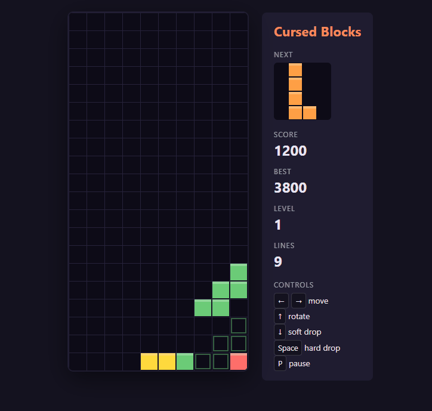

# Cursed Blocks

A falling-block puzzle game where none of the pieces are the ones you're used to. Instead of the
classic four-cube shapes, you get awkward pieces of 2 to 6 cubes, and from level 2 to level 6 a
new, nastier "curse" piece joins the game as it speeds up.

**▶️ Play it in your browser:** https://leonkozak.github.io/cursed-blocks/



## Features

- **12 original pieces** of 2 to 6 cubes. Seven are in play from the start; then one curse
  unlocks per level: Bridge (level 2), Plus (3), Zag (4), Fork (5) and Crown (6).
- **Levels and speed:** every 10 lines cleared raises the level and makes pieces fall faster.
- **Scoring:** 100 / 300 / 500 / 800 points for clearing 1 / 2 / 3 / 4 lines at once,
  multiplied by the level.
- **Ghost piece** showing where the current piece will land, a **next piece** preview, and a
  flash when lines clear.
- **High score** saved in your browser.

## Run it locally

You need [Node.js](https://nodejs.org/) 18 or newer.

```bash
git clone https://github.com/LeonKozak/cursed-blocks.git
cd cursed-blocks
npm install
npm run dev
```

Then open http://localhost:5173/cursed-blocks/.

Other commands:

| Command | What it does |
| --- | --- |
| `npm run typecheck` | Checks the TypeScript for errors without building |
| `npm run build` | Type check, then build the game into `dist/` |
| `npm run preview` | Serve the built game from `dist/` |

## How it's built

TypeScript and an HTML canvas, bundled with Vite. No game engine or UI framework. Game logic,
drawing and input are kept in separate files:

| File | What it does |
| --- | --- |
| `src/pieces.ts` | The 12 pieces, their unlock levels, rotation and the shuffled piece bag |
| `src/board.ts` | The grid: collisions, placing pieces and clearing lines |
| `src/game.ts` | Game rules: gravity, moves, scoring, levels, pause and game over |
| `src/renderer.ts` | All the canvas drawing, with no game logic |
| `src/input.ts` | Keyboard controls, which only call game actions |
| `src/main.ts` | Connects everything and runs the game loop |

**Deployment:** every push to `main` runs a GitHub Actions workflow
(`.github/workflows/deploy.yml`) that type-checks and builds the game, then publishes it to
GitHub Pages. So the live version always matches the code.

## How I built this

I built it with [Claude Code](https://www.anthropic.com/claude-code), one
step at a time: the grid, then the pieces, gravity, controls, collisions, line clearing,
scoring, game over and finally polish. The rules I gave it are in [CLAUDE.md](CLAUDE.md).

The TypeScript runs in strict mode, so unused variables and type mistakes fail the build, and
I checked each step by playing it in the browser.